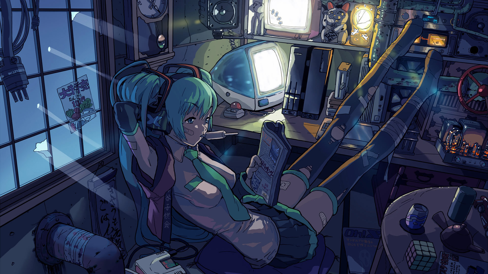

  

  

<table>
<tr>
<td width="60%" valign="top">

<h2>about me</h2>

compsci student  
indie web lover  
linux ricing enthusiast  
occasional gamedev

<h2>interests</h2>

dorky stuff in general  
mid-level programming  
retro web · open source

</td>
<td width="40%" align="center" valign="middle">

</td>
</tr>
</table>

  

  

✦ 
<a href="https://github.com/killmorrow?tab=repositories">repositories</a>
 ✦

 

  

  

  

